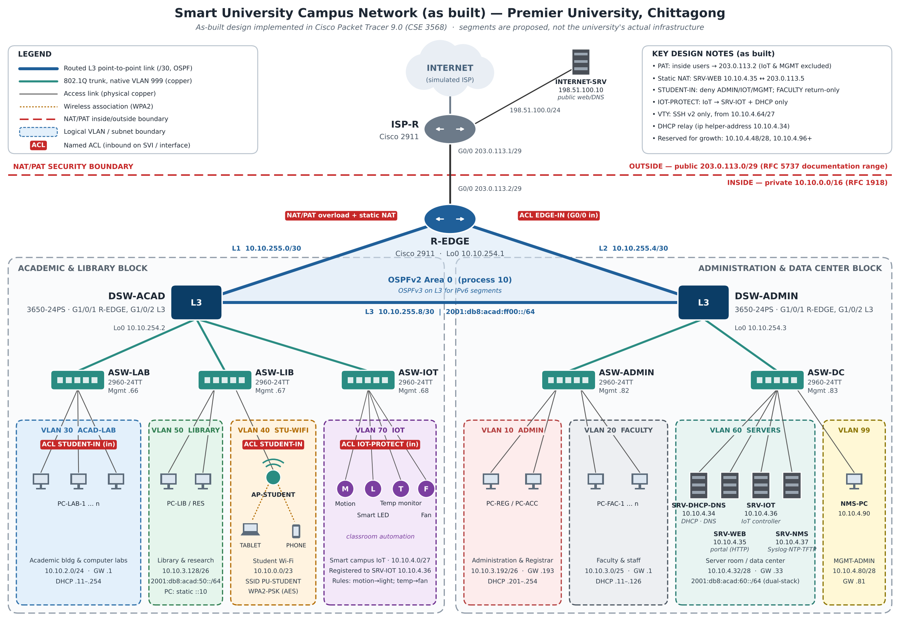

# University Campus Network Using Cisco Packet Tracer

A smart university campus network designed, configured and tested in **Cisco Packet Tracer 9.0**.
The campus segments are a simulation; they do not describe any real university's infrastructure.

## Features

| Area | Implementation |
|---|---|
| Design | Hierarchical, two blocks (Academic & Library / Admin & Data Center), redundant routed triangle |
| Addressing | VLSM from `10.10.0.0/16`, 9 VLANs, `/30` routed links, `/32` loopbacks |
| Switching | 802.1Q trunks (native VLAN 999, pruned allowed lists), port-security, PortFast, BPDU Guard, unused ports parked in VLAN 998 |
| Inter-VLAN routing | SVIs on two Catalyst 3650 multilayer switches |
| Routing | OSPFv2 Area 0 + OSPFv3 for IPv6, default route originated by the edge router |
| IPv6 | Dual-stack on the library (VLAN 50) and server (VLAN 60) segments, `2001:DB8:ACAD::/48` |
| Services | Central DHCP (6 pools via `ip helper-address`), DNS (A + AAAA), web portal, IoT server, Syslog |
| Security | Extended ACLs `STUDENT-IN`, `IOT-PROTECT`, `EDGE-IN`; `MGMT-ONLY` VTY ACL; SSH v2 only |
| NAT | PAT for campus users, static NAT for the web portal (`10.10.4.35 ↔ 203.0.113.5`) |
| Wireless | SSID `PU-STUDENT`, WPA2-PSK / AES, VLAN 40 (`/23`) |
| IoT | Motion → light and temperature → fan rules (30 °C on / 26 °C off) on a registration server |

## VLAN plan

| VLAN | Name | Subnet | Gateway |
|---|---|---|---|
| 10 | ADMIN | 10.10.3.192/26 | .193 |
| 20 | FACULTY | 10.10.3.0/25 | .1 |
| 30 | ACAD-LAB | 10.10.2.0/24 | .1 |
| 40 | STU-WIFI | 10.10.0.0/23 | 10.10.0.1 |
| 50 | LIBRARY | 10.10.3.128/26 + 2001:DB8:ACAD:50::/64 | .129 |
| 60 | SERVERS | 10.10.4.32/28 + 2001:DB8:ACAD:60::/64 | .33 |
| 70 | IOT | 10.10.4.0/27 | .1 |
| 98 | MGMT-ACAD | 10.10.4.64/28 | .65 |
| 99 | MGMT-ADMIN | 10.10.4.80/28 | .81 |

## Repository contents

| File / folder | Description |
|---|---|
| `University_Campus_Network_Premier_University.pkt` | Packet Tracer project file (open with Packet Tracer 9.0+) |
| `Project_Report.pdf` / `.docx` | Final report with testing results and appendix |
| `Project_Proposal.pdf` / `.docx` | Project proposal with CEP/CEA mapping |
| `Project_Guide_Bangla_A_to_Z.pdf` | Full explanation in Bangla, plus viva questions and answers |
| `Device_Configurations/` | CLI configuration scripts for all 9 network devices + GUI settings |
| `IP_Addressing_Plan.csv` | Full VLSM/IPv6 addressing plan |
| `Testing_Matrix.csv` | 31 tests: 23 PASS, 2 FAIL, 6 NOT TESTED |
| `Screenshots/` | 24 screenshots from the running simulation |
| `Topology.png` | Design diagram |

## Test summary

23 of 31 tests passed. Two failed: SLAAC on VLAN 50 (a static IPv6 address is used instead), and the console enable secret on R-EDGE being rejected (it works over SSH). Six were not run, among them OSPF failover and the temperature rule. Details are in `Testing_Matrix.csv` and the report.

## Lab credentials

`netadmin / PULab2026` (SSH from 10.10.4.64/27), Wi-Fi `PUStudent2026`, IoT server `iotadmin / PUIoT2026`.
These are demonstration values for the simulation only.
